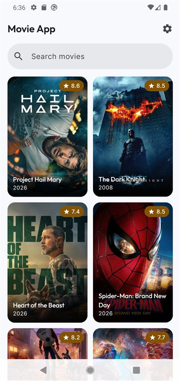
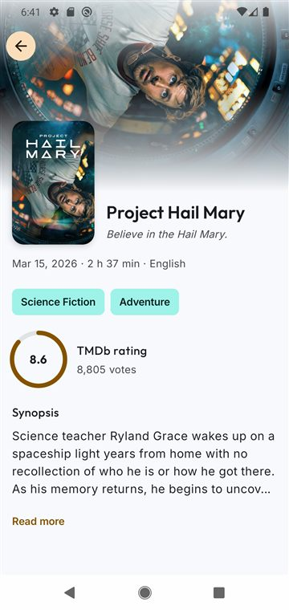
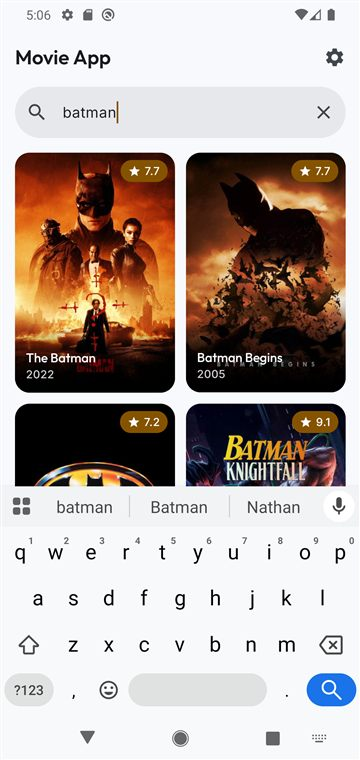
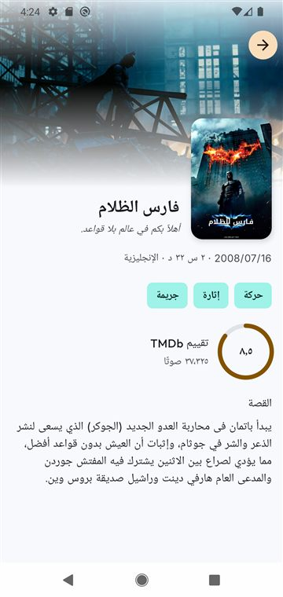
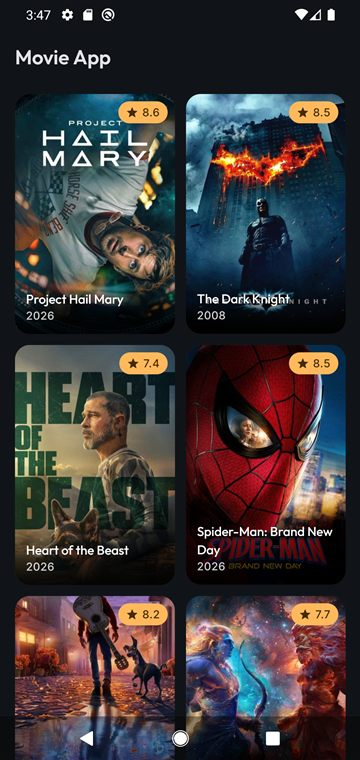
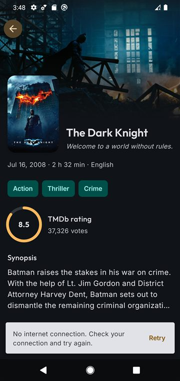

# Movie App

An Android app for browsing popular movies from [TMDb](https://www.themoviedb.org/): a paginated grid limited to films rated PG-13 or lower, a details screen, and search by title that updates as you type. Movies and details are cached, so the app opens instantly and keeps working offline. It is available in English and Arabic (right to left), in light and dark themes.

Built with Kotlin and Jetpack Compose, following **Clean Architecture** with **MVI**, **Hilt**, **Paging 3 + Room** and **Navigation 3**.

| Movies | Details | Search |
|:---:|:---:|:---:|
|  |  |  |
| **Arabic (RTL)** | **Dark theme** | **Offline, from the cache** |
|  |  |  |

## Features

- **Popular movies:** a paginated poster grid with title, release year and rating. The next page loads as you scroll, with a footer that shows progress or an error with Retry.
- **Content filter:** every TMDb request includes `include_adult=false`, `certification_country=US` and `certification.lte=PG-13`.
- **Movie details:**
  - a backdrop with parallax and the poster;
  - title and tagline;
  - release date, runtime and language;
  - genres;
  - an animated rating ring with the vote count;
  - an expandable synopsis.
- **Search by title:**
  - results update about 350 ms after you stop typing, and quick typing sends a single request;
  - a cleared search returns to the list where you left it;
  - "no results" shows what you searched for.
- **Offline-first cache:**
  - the list and every opened movie are stored in Room and shown at once on launch;
  - they are then refreshed in the background, and the screen updates when fresh data arrives;
  - if the refresh fails, saved data stays on screen with a clear notice.
- **Clear errors:** no internet, timeouts, an invalid token and server errors each have their own message and a Retry action, in both languages.
- **Settings:**
  - language: System, English or العربية, switched instantly; content is fetched again in the new language;
  - theme: System, Light or Dark.
- **Accessible and adaptive:**
  - screen-reader labels and 48 dp touch targets;
  - layouts that hold up at 200 % text size and in landscape;
  - edge to edge;
  - right-to-left support.

## Architecture

Three layers per feature, with dependencies pointing inwards to a pure-Kotlin domain:

```
presentation (Compose + ViewModels, MVI) ──▶ domain (models, use cases, repository interfaces) ◀── data (Retrofit, Room, mappers)
```

- **MVI:** each screen has one immutable `UiState` (`StateFlow`), a single `onAction(UiAction)` entry point, and one-time effects through a `Channel`.
- **Cache:** the list uses Paging 3 with a `RemoteMediator`, so Room is the single source of truth. Details use a finite cache-then-network flow.
- **Errors:** every failure becomes a typed `DomainError` in the data layer, so ViewModels never see network exceptions.
- **Structure:** packaged by feature (`movies`, `details`, `settings`), with shared code in `core/`.

The full picture and the reasons behind each choice:

| Document | What it covers |
|---|---|
| [Architecture](docs/ARCHITECTURE.md) | Layers, packages, MVI, data flows, errors, navigation, UI system |
| [Walkthroughs](docs/WALKTHROUGHS.md) | Each scenario traced class by class at run time |
| [Decision records](docs/adr/README.md) | 8 ADRs: MVI naming, paging outside state, the cache, the search filter limitation, modules, packaging, navigation, errors |
| [Testing](docs/TESTING.md) | Strategy, tools and every test class |
| [FAQ](docs/FAQ.md) | Design questions and answers, known limitations |
| [Feature docs](docs/features/) | How each task was built, step by step (29 documents) |
| [Requirements](docs/requirements.md) and [plan](docs/PLAN.md) | The task's requirements (numbered) and the delivery plan with coverage |
| [AI usage](docs/AI_USAGE.md) | How Claude Code was used, what was checked by hand, and the limits |

## Tech stack

| Area | Libraries |
|---|---|
| Language and build | Kotlin 2.4.21, AGP 9.2.1, Gradle version catalog, KSP |
| UI | Jetpack Compose (BOM 2026.09.00), Material 3, Coil 3.6.3 |
| Navigation | Navigation 3 1.2.1 |
| Architecture | AndroidX Lifecycle and ViewModel 2.11.0, Hilt 2.60.1 |
| Asynchrony | Kotlin Coroutines and Flow 1.11.0 |
| Networking | Retrofit 3.0.0, OkHttp 5.5.1, kotlinx.serialization 1.12.0 |
| Pagination and cache | Paging 3.5.3, Room 2.8.5 |
| Preferences and locale | DataStore 1.3.0, AppCompat 1.8.0 (per-app language, night mode) |
| Logging | Timber 5.0.1 (debug builds only) |
| Testing | JUnit 4, Turbine, kotlinx-coroutines-test, MockWebServer, paging-testing, Room testing, Compose UI Test, Hilt testing |

minSdk 26, targetSdk 36, compileSdk 37.

## Getting started

### Requirements
- Android Studio with support for AGP 9.2.1
- JDK 17 or newer (Android Studio's bundled JDK works)
- A free TMDb account

### 1. Get a TMDb token

The app authenticates with a TMDb **v4 Read Access Token**. The token is never committed to the repository.

1. Sign in at [themoviedb.org](https://www.themoviedb.org/) and open **Settings → API**.
2. Copy the **API Read Access Token**. It's the long token that starts with `eyJ`, not the shorter "API Key".

### 2. Configure it

Add the token to `local.properties` in the project root (the file is git-ignored):

```properties
TMDB_ACCESS_TOKEN=eyJhbGciOiJIUzI1NiJ9...
```

Quotes around the value are optional; they are stripped.

**Other ways to provide the token** (checked in this order after `local.properties`):

| Source | Example | Typical use |
|--------|---------|-------------|
| Gradle property | `./gradlew assembleDebug -PTMDB_ACCESS_TOKEN=eyJ...`, or a line in `~/.gradle/gradle.properties` | One token for all your local projects |
| Environment variable | `TMDB_ACCESS_TOKEN=eyJ... ./gradlew assembleDebug` | CI (for example, a GitHub Actions secret) |

If no token is found, the build still succeeds and prints a warning. The app then can't load any data, and every request fails as *Unauthorized* with a message that points to the token.

### 3. Run

Open the project in Android Studio, let Gradle sync, and run the `app` configuration on an emulator or device (Android 8.0, API 26, or newer). From the command line:

```bash
./gradlew installDebug
```

On Windows, use `gradlew.bat`.

## Tests

```bash
./gradlew testDebugUnitTest                   # 181 unit tests (JVM)
./gradlew connectedDebugAndroidTest           # 57 instrumented tests (emulator or device required)
./gradlew createDebugUnitTestCoverageReport   # JaCoCo report → app/build/reports/coverage/test/debug/index.html
```

No TMDb token is needed to run any test: unit tests use MockWebServer and fakes, and instrumented tests use in-memory databases, fixed paging data and, for end-to-end navigation, fake repositories in a Hilt test graph. Instrumented tests uninstall the app when they finish. See [Testing](docs/TESTING.md) for what each test class covers.

## Debugging with Logcat

Debug builds log through [Timber](https://github.com/JakeWharton/timber). Release builds log nothing.

| What you want to see | Logcat filter |
|----------------------|---------------|
| Every TMDb request and response (URL, status, time, full JSON body) | `package:mine tag:TmdbHttp` |
| Handled failures, with the original exception and stack trace | `package:mine level:warn` |
| Everything the app logs | `package:mine` |

The access token never appears in logs: the `Authorization` header is shown as `██`. Search text is never logged, only its length.

## Project structure

```
app/src/main/java/com/trianglz_task_ahmedhussin/
├── MovieApplication.kt · MainActivity.kt
├── core/       network, database, design system, navigation, error model, DI
└── feature/
    ├── movies/     list + search      (data · domain · presentation · di)
    ├── details/    movie details      (data · domain · presentation · di)
    └── settings/   language + theme   (data · domain · presentation · di)
```

## Known limitations

| Limitation | Notes |
|---|---|
| Search results can include titles above PG-13 | TMDb applies the certification filter only on `/discover/movie`; search still sends it ([ADR 0004](docs/adr/0004-search-certification-filter.md)) |
| The search text is not restored after the system kills the app in the background | Rotation and language or theme changes keep it |
| No automatic retry when the connection comes back | Retry is one tap on every error |
| The token is compiled into the APK | Acceptable for a read-only demo token; a production app would call TMDb through its own backend |
| The release build is not minified | R8 is disabled; enabling it needs keep rules and a release test pass |

More detail in the [FAQ](docs/FAQ.md#known-limitations).

## Git workflow

Git Flow with one feature branch per phase, one commit per task and one pull request per phase into `develop`; releases go through `release/*` into `master`. See [`docs/GIT_FLOW.md`](docs/GIT_FLOW.md).
