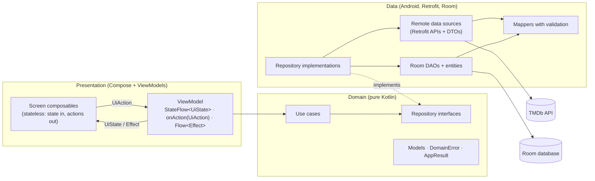
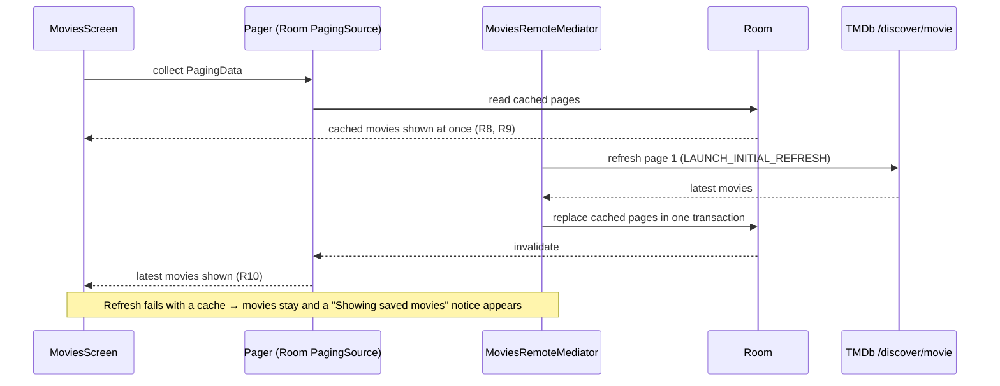

# Architecture

This document explains how the Movie App is structured and how data moves through it. It covers the current state of the code; the reasons behind the main choices are recorded as decision records in [`docs/adr/`](adr/README.md), and every task's details are in [`docs/features/`](features/).

## 1. Overview

The app shows popular TMDb movies rated PG-13 or lower in a paginated grid, opens a details screen for any movie, and searches by title while the user types. The movie list and details are cached in Room: the app shows the cache at once, refreshes it in the background, and updates the screen when fresh data arrives. Settings switch between Arabic and English and between light and dark.

It follows **Clean Architecture** with three layers (data → domain → presentation), uses **MVI** in the presentation layer, **Hilt** for dependency injection, **Jetpack Compose** with Material 3 for the UI, and **Navigation 3** between screens.

## 2. Layers and the dependency rule



**Rules that hold across the codebase**
- **Dependencies point inwards.** Presentation and data depend on the domain; the domain depends on nothing app-specific. Its only third-party imports are Kotlin coroutines, `java.time`, `javax.inject` and Paging's pure-Kotlin types (`PagingData`, `LoadState`, from `paging-common`).
- **Only the data layer sees network and database types.** DTOs and entities are mapped to domain models before they leave it, and exceptions are converted to a `DomainError` (section 6). ViewModels never see Retrofit, OkHttp or Room types (R21).
- **Every repository is an interface in the domain**, bound to its implementation in one Hilt module per feature (`MoviesModule`, `DetailsModule`, `SettingsModule`).
- **Dispatchers are injected** (`@IoDispatcher`, `@DefaultDispatcher`) where work leaves the main thread. Retrofit and Room `suspend` functions are already main-safe, so most data sources need no switch.
- **Logging uses Timber**, only in the data and presentation layers, and never logs tokens or user input (search text is logged by length only).

## 3. Package structure

One Gradle module, **packaged by feature**, with the three layers inside each feature (see [ADR 0005](adr/0005-single-module.md) and [ADR 0006](adr/0006-package-by-feature.md)). Shared code lives in `core/`.

```
com.trianglz_task_ahmedhussin
├── MovieApplication.kt        Hilt application; Coil image loader; applies the saved theme at start-up
├── MainActivity.kt            Single activity: edge-to-edge, locale sync, hosts AppNavigation
├── core/
│   ├── common/                dispatcher qualifiers, LocaleProvider
│   ├── domain/                DomainError, DomainException, AppResult (pure Kotlin)
│   ├── network/               Retrofit/OkHttp factory, interceptors (auth, filters, language),
│   │                          error mapping + safeApiCall, image URLs, shared value validation
│   ├── database/              MovieDatabase (one Room database for all features)
│   ├── designsystem/          theme (colours, type, shapes, spacing), shared components, previews
│   ├── ui/error/              DomainError → localized message
│   ├── navigation/            route keys, NavDisplay host
│   └── di/                    NetworkModule, DatabaseModule, DispatchersModule
└── feature/
    ├── movies/                popular list + search (one screen)
    │   ├── data/              remote (API, DTOs, search PagingSource), local (entities, DAOs),
    │   │                      mediator (RemoteMediator), mapper, repository (list + search)
    │   ├── domain/            Movie, MoviesRepository, MovieSearchRepository,
    │   │                      GetMoviesUseCase, SearchMoviesUseCase, SearchQueryValidator
    │   ├── presentation/      MoviesViewModel, contract, ListStatus mapper, MoviesScreen, components
    │   └── di/                MoviesModule
    ├── details/
    │   ├── data/              remote (API, DTO), local (entity, converters, DAO), mapper, repository
    │   ├── domain/            MovieDetails, MovieDetailsRepository, GetMovieDetailsUseCase
    │   ├── presentation/      DetailsViewModel (assisted injection), contract, DetailsScreen, components
    │   └── di/                DetailsModule
    └── settings/
        ├── data/              theme (DataStore), language (per-app locales), night-mode applier
        ├── domain/            ThemeMode, AppLanguage, SettingsRepository, use cases
        ├── presentation/      SettingsViewModel, contract, SettingsScreen
        └── di/                SettingsModule
```

## 4. Presentation: MVI

Every screen has the same shape ([ADR 0001](adr/0001-mvi-naming.md)):

| MVI term | In this code | Example (Details) |
|---|---|---|
| **Model** | one immutable `UiState` data class, exposed as `StateFlow` | `DetailsUiState(status, isRefreshing, isSynopsisExpanded)` |
| **Intent** | a sealed `UiAction`, sent through a single `onAction()` | `Retry`, `Back`, `ToggleSynopsis` |
| **Effect** | a sealed `Effect`, delivered once through a `Channel` | `NavigateBack`, `ShowRefreshError(error)` |

- **Stateless screens.** Each screen is split into a stateful `…Route` (gets the ViewModel, collects state and effects) and a stateless `…Screen(state, onAction)`, which is what previews and UI tests render.
- **Effects are collected only while the screen is visible** (`repeatOnLifecycle(STARTED)`), so navigation never fires in the background.
- **Paged lists are separate flows.** The popular list and the search results are `Flow<PagingData<…>>` next to the state, not inside it ([ADR 0002](adr/0002-pagingdata-outside-uistate.md)). A pure function, `CombinedLoadStates.toListStatus()`, turns Paging's load states into one of Loading, Empty, Error or Content, so composables stay free of that logic.
- **Formatting happens before the UI.** Display models (`MovieUi`, `MovieDetailsUi`) carry locale-formatted dates and numbers. Texts that come from string resources (runtime, status labels, plurals) are worded in the UI.

## 5. Data flows

### 5.1 Popular list: cache first with a `RemoteMediator`



Room is the single source of truth: the screen only ever reads Room, and the mediator writes to it. Appending loads the next page into Room until TMDb's last page (capped at page 500, which TMDb enforces). See [ADR 0003](adr/0003-remotemediator-cache.md).

### 5.2 Details: cache, then network, then complete

```
GetMovieDetailsUseCase(id) ─▶ MovieDetailsRepositoryImpl.movieDetails(id): Flow<AppResult<MovieDetails>>
   1. cached row?  → emit Success(cached)
   2. GET /movie/{id} → validate → on success save to Room
   3. emit Success(fresh) or Failure(error), then complete
DetailsViewModel:
   Success → Content (isRefreshing = true until the flow completes)
   Failure with content on screen → snackbar effect, content stays
   Failure with nothing on screen → Error with Retry
```

The flow is finite on purpose: its completion is what tells the ViewModel the refresh is over.

### 5.3 Search: debounced, network only

```
QueryChanged(text) ─▶ state.query (instant, capped at 100)
state.query ─▶ debounce 350 ms (0 ms when blank) ─▶ SearchQueryValidator ─▶ distinctUntilChanged
            ─▶ flatMapLatest { SearchMoviesUseCase(query) } ─▶ Pager { SearchPagingSource } ─▶ cachedIn
```

`flatMapLatest` cancels an old search when the query changes. The paging source skips movies it already returned on an earlier page, because the grid is keyed by movie ID. Search results are not cached. TMDb ignores the certification filter on this endpoint ([ADR 0004](adr/0004-search-certification-filter.md)).

### 5.4 Settings

The theme is stored in Preferences DataStore and applied app-wide through AppCompat night mode; `MovieApplication` reads it once before the first screen and then follows changes. The language uses AndroidX per-app locales, which Android stores and which recreate the screen in the new language; `MainActivity` keeps `Locale.getDefault()` in sync with the resources so every number and the TMDb `language` parameter follow it.

## 6. Networking and errors

- **One OkHttp client** with interceptors that add the Bearer token, `language`, and the three required filter parameters (`include_adult=false`, `certification_country=US`, `certification.lte=PG-13`) to **every** request (R23–R26). HTTP logging goes through Timber in debug builds only, with the token redacted.
- **Typed errors.** `Throwable.toDomainError()` maps exceptions to a closed set: `NoInternet`, `Timeout`, `Unauthorized`, `NotFound`, `RateLimited`, `Server`, `Unknown` ([ADR 0008](adr/0008-typed-domain-errors.md)).
  - Non-paged calls return `AppResult<T>` through `safeApiCall`.
  - Paged loads report `LoadState.Error(DomainException(error))`.
  - The UI maps every `DomainError` to one localized message (`messageRes()`), shown by the shared `ErrorView` or a snackbar.
- **Validation at the edge (R22).** Mappers drop unusable items (no ID, blank title), clamp ratings, strictly parse dates, and turn empty text into `null`. Search input is trimmed, whitespace is collapsed, and blank means idle.

## 7. Navigation

Navigation 3 ([ADR 0007](adr/0007-navigation-3.md)). The back stack is a saveable list of `@Serializable` route keys (`MoviesRoute`, `DetailsRoute(movieId)`, `SettingsRoute`), so it survives configuration changes and process death. `rememberViewModelStoreNavEntryDecorator` gives every entry its own ViewModel store, so each `DetailsRoute(id)` gets its own `DetailsViewModel`, built with the movie ID through Hilt assisted injection. Back removes the exact entry, so a double tap can never pop the list.

## 8. UI system

- **Theme:** Material 3 with an amber/teal/slate palette, light and dark schemes defined only in the theme layer, and bundled Outfit and Inter fonts.
- **Edge to edge:**
  - content draws behind the system bars, with insets applied per element (including side insets in landscape);
  - a surface-coloured gradient keeps status icons readable over the details backdrop;
  - the search screen fits above the keyboard (`fitInside(WindowInsetsRulers.Ime)`).
- **Localization:** every string is in `values` and `values-ar`, layouts use start/end, and directional icons auto-mirror.
- **Accessibility:**
  - every tappable element has a label, and touch targets are at least 48 dp;
  - full-screen states scroll when large text does not fit;
  - the rating ring reads as one sentence.

## 9. Testing

| Kind | Where | What |
|---|---|---|
| Unit (JVM), 181 tests | `app/src/test` | Mappers and validation; error mapping; interceptors and APIs against MockWebServer; RemoteMediator and paging sources; repositories with fakes; use cases; ViewModels in virtual time (Turbine); settings storage |
| Instrumented, 57 tests | `app/src/androidTest` | Room DAOs and the RemoteMediator on real SQLite; Compose UI tests for the list, search, details and the status layout; the production Hilt graph; end-to-end navigation with fake repositories |

Run them with `gradlew.bat testDebugUnitTest` and `gradlew.bat connectedDebugAndroidTest`.

## 10. Decision records

| ADR | Decision |
|---|---|
| [0001](adr/0001-mvi-naming.md) | MVI with `UiState` / `UiAction` / `Effect` |
| [0002](adr/0002-pagingdata-outside-uistate.md) | Paged lists live next to the `UiState`, not inside it |
| [0003](adr/0003-remotemediator-cache.md) | Room + `RemoteMediator` for the list cache; a finite cache-then-network flow for details |
| [0004](adr/0004-search-certification-filter.md) | Search sends the certification filter that TMDb ignores there |
| [0005](adr/0005-single-module.md) | One Gradle module |
| [0006](adr/0006-package-by-feature.md) | Package by feature, layers inside |
| [0007](adr/0007-navigation-3.md) | Navigation 3 |
| [0008](adr/0008-typed-domain-errors.md) | A closed `DomainError` type instead of exceptions or `kotlin.Result` |
