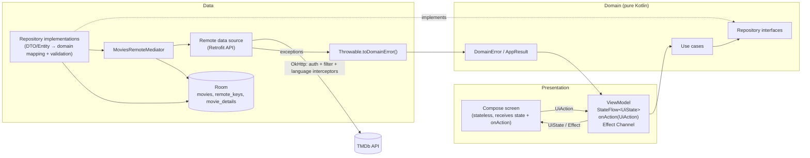
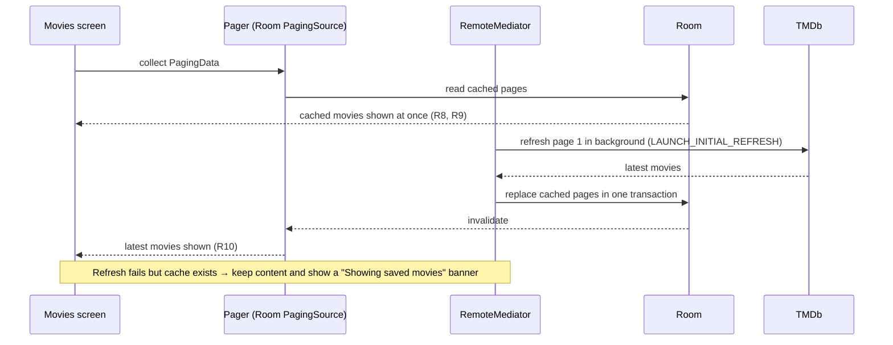

# Movie App: Master Plan

## Progress tracker

| | |
|---|---|
| **Current phase** | Phase 4: Quality, documentation and delivery |
| **Last completed task** | T4.2: Code and architecture documentation |
| **Next task** | T4.3: README |

Scope comes from [`requirements.md`](requirements.md). Working rules come from [`CLAUDE.md`](../CLAUDE.md).

---

## 1. Overview

The app shows popular TMDb movies rated PG-13 or lower in a paginated grid. Tapping a movie opens a details screen with its synopsis, rating, genres and other information. A search bar on the list screen updates results while the user types. Movie data is cached in Room: on start the app shows cached data immediately, refreshes it in the background, and updates the UI when the new data arrives. The code follows Clean Architecture (data → domain → presentation), uses MVI in the presentation layer, and uses Hilt for dependency injection. Network and HTTP failures become typed domain errors before they reach any ViewModel.

## 2. Tech stack

Versions are not fixed here. They are looked up as current stable releases during T0.2 and checked against AGP 9.2.1 and its built-in Kotlin support.

| Choice | Why |
|--------|-----|
| Kotlin | Required (R14). It is the standard language for Android and works well with coroutines and Compose. |
| Jetpack Compose + Material 3 | Required (R19, R32). Declarative UI fits MVI's single immutable state. |
| Gradle version catalog | Keeps every dependency and version in one place (`libs.versions.toml`). |
| Hilt (with KSP) | Required DI framework (R20). Integrates with ViewModels and Android testing. |
| Coroutines + Flow | Required (R15). `StateFlow` for state, `Flow` for streams, structured concurrency. |
| Retrofit + OkHttp + kotlinx.serialization | Type-safe TMDb API calls. Interceptors add the auth header and the required filter parameters to every request (R24–R26). kotlinx.serialization needs no reflection. |
| Coil 3 | Compose-first image loading with memory and disk caching and crossfade for posters and backdrops. |
| Navigation 3 | The CLAUDE.md default. The back stack is plain state, it works with Hilt ViewModels, and it supports adaptive scenes later (E7). |
| Paging 3 + `RemoteMediator` | Pagination (R3) with built-in footer load states (R4). `RemoteMediator` combined with Room gives the cache-then-network flow (R7–R10). |
| Room | Local cache for the list and details (R7, R38). Its `PagingSource` emits updates automatically when data changes (R10). |
| DataStore | The theme preference (E1, done in T2.6). The language is stored by AndroidX per-app locales instead. |
| JUnit, MockK, Turbine, kotlinx-coroutines-test | Unit tests (R27–R29), as CLAUDE.md specifies. |
| MockWebServer | Data-layer tests of real Retrofit calls, including checking that R24–R26 are present on every request. |
| paging-testing, Room testing | `RemoteMediator` and DAO tests. |
| Compose UI Test + Hilt testing (`HiltAndroidRule`) | Instrumentation/UI tests (R30). |

### Where the PDF requires something different from the CLAUDE.md defaults

1. **Room** is "only if the requirements need offline data". **R7–R10 require a local cache, so Room is required.**
2. **Paging 3** is "if the lists are paginated". **R3 requires pagination, so Paging 3 is required.**
3. **Presentation pattern:** CLAUDE.md describes "MVVM with unidirectional data flow (MVI style)", while the PDF requires **MVI** (R17). The structure is the same. The docs call it MVI and map the names explicitly (Intent = `UiAction`, Model = `UiState`, side effect = Effect). See Q7.
4. **Tests:** CLAUDE.md lists only unit-test libraries. **R30 also requires instrumentation/UI tests**, so Compose UI Test, Hilt testing and the AndroidX test runner are added.
5. **Git workflow:** the PDF requires **Git Flow** (R31): `develop`, `feature/*`, `release/*`, and `master` for releases. CLAUDE.md's "don't commit unless I ask" still applies. Each task suggests a branch name and a commit message.
6. **Theme:** the template enables dynamic color by default. It is turned **off** so that the app's own palette gives the polished, branded look R33 asks for. Dynamic color could become an option later.
7. **Arabic:** CLAUDE.md requires Arabic translations in `values-ar` and RTL-safe layouts from the start, while the in-app language switch is an extra. Strings and RTL-safe layouts are therefore written from day one. Only the **in-app switch and the full RTL QA** are extra E2.
8. **"Modular" (R18):** the plan uses one module packaged by feature (the CLAUDE.md default). A multi-module split is extra E16. See Q6.

## 3. Architecture



**Cache flow (R7–R10):**



**Rules**
- The domain layer has no Android, Retrofit or Room imports.
- ViewModels only ever see `DomainError`, never `HttpException` or `IOException` (R21).
- Dispatchers are injected (`@IoDispatcher`, `@DefaultDispatcher`) and never hardcoded.
- Each feature has one Hilt module that binds its repository interface to its implementation.

**Package structure** (`com.trianglz_task_ahmedhussin`)

```
├── MovieApplication.kt            @HiltAndroidApp
├── MainActivity.kt                @AndroidEntryPoint, edge-to-edge, NavDisplay host
├── core/
│   ├── common/                    dispatcher qualifiers, LocaleProvider
│   ├── domain/                    DomainError, DomainException, AppResult (pure Kotlin)
│   ├── network/                   Retrofit/OkHttp setup, interceptors, error mapper, safeApiCall, image URL builder
│   ├── ui/error/                  DomainError → localized message
│   ├── database/                  MovieDatabase, converters
│   ├── designsystem/              theme (Color, Type, Shape, Spacing, Theme), @ThemePreviews
│   │   └── component/             RatingBadge, LoadingView, EmptyView, ErrorView/RetryButton (+ PosterCard, PagingFooter in T1.5)
│   ├── navigation/                Routes (MoviesRoute, DetailsRoute(id)), AppNavigation
│   └── di/                        NetworkModule, DatabaseModule, DispatchersModule
└── feature/
    ├── movies/                    list + search (same screen, R11)
    │   ├── data/
    │   │   ├── remote/            MoviesApi, DTOs, MoviesRemoteDataSource, SearchPagingSource
    │   │   ├── local/             MovieEntity, RemoteKeyEntity, MovieDao, RemoteKeyDao
    │   │   ├── mediator/          MoviesRemoteMediator
    │   │   ├── mapper/            DTO ↔ Entity ↔ domain mappers (with validation)
    │   │   └── repository/        MoviesRepositoryImpl
    │   ├── domain/
    │   │   ├── model/             Movie
    │   │   ├── repository/        MoviesRepository, MovieSearchRepository
    │   │   └── usecase/           GetMoviesUseCase, SearchMoviesUseCase, SearchQueryValidator
    │   ├── presentation/          MoviesViewModel, MoviesUiState, MoviesUiAction, MoviesEffect,
    │   │   │                      ListStatus mapper, MoviesScreen
    │   │   └── component/         MovieGrid, MovieCard, MovieSearchBar, CachedDataNotice, ScrollToTopButton
    │   └── di/                    MoviesModule
    ├── details/
    │   ├── data/                  remote (DetailsApi, DTO), local (MovieDetailsEntity, DAO), mapper, repository
    │   ├── domain/                MovieDetails, MovieDetailsRepository, GetMovieDetailsUseCase
    │   ├── presentation/          DetailsViewModel, DetailsUiState, DetailsUiAction, DetailsEffect, DetailsScreen
    │   │   └── component/         DetailsHeader, DetailsTopBar, InfoRow, GenreChips, RatingSection, Synopsis
    │   └── di/                    DetailsModule
    └── settings/                  (T2.6, extras E1 + E2)
        ├── data/                  ThemeModeDataSource (DataStore), AppLanguageDataSource (per-app locales), NightModeApplier, repository
        ├── domain/                ThemeMode, AppLanguage, SettingsRepository, use cases
        ├── presentation/          SettingsViewModel, SettingsUiState, SettingsUiAction, SettingsEffect, SettingsScreen
        └── di/                    SettingsModule (DataStore)
```

## 4. Screens

### 4.1 Movies screen (list + search), the start destination

**Purpose:** browse popular, filtered movies (R1–R4), search by title (R11–R13), and open details (R5).

**State and data**

| Field | Type | Meaning |
|-------|------|---------|
| `query` | `String` | Current text in the search bar (what the user typed). |
| `isSearching` | `Boolean` | `true` once the debounced, validated query is not blank, so the search results are shown instead of the list. It follows the debounced query (not each keystroke), so the list stays visible while the user is still typing; clearing switches back at once. |
| `movies` | `Flow<PagingData<MovieUi>>` | Cached and refreshed list from the `RemoteMediator`, exposed **next to** the `StateFlow` because `PagingData` is a stream and not a value. This is documented in an ADR. |
| `searchResults` | `Flow<PagingData<MovieUi>>` | Debounced search results (`flatMapLatest` on the query). |

`MovieUi` holds: `id`, `title`, `posterUrl?`, `releaseYear?`, `ratingText`.

**User actions (`MoviesUiAction`):** `QueryChanged(text)`, `ClearQuery`, `MovieClicked(id)`, `DismissCachedNotice`, `SettingsClicked`. Retry is not an action: the screen calls `LazyPagingItems.retry()` (T1.5).
**Effects (`MoviesEffect`):** `NavigateToDetails(id)`, `ShowSnackbar(message)`.

**States.** A tested pure function `LoadStates → ListStatus` turns Paging load states into one of the four states below, so the composable stays free of logic (R21).

| State | When | UI |
|-------|------|----|
| **Loading** | First refresh and nothing cached | Grid of placeholder cards (shimmer is extra E4). |
| **Content** | Items exist | Poster grid. While appending: a footer spinner (R4). Append error: a footer with the error message and Retry (R4). Background refresh failed but cached items exist: a dismissible "Showing saved movies" banner with Retry (R9). |
| **Empty** | Refresh finished with 0 items | List: "No movies available". Search: "No results for '‹query›'" with an illustration. |
| **Error** | Refresh failed and nothing cached | Full-screen error that matches the `DomainError` (no internet, server, unauthorized API key, …), with Retry. |

### 4.2 Details screen

**Purpose:** show full details for one movie (R6), cache-then-network (R7, Q5).

**State (`DetailsUiState`)**

| Field | Type | Meaning |
|-------|------|---------|
| `status` | `Loading` \| `Content(details: MovieDetailsUi)` \| `Error(error: DomainError)` | Main screen state. |
| `isRefreshing` | `Boolean` | Cached content is shown while the network refresh is still running. |
| `isSynopsisExpanded` | `Boolean` | Whether the synopsis is expanded. |

`MovieDetailsUi` holds: title, tagline, backdrop/poster URLs, release date (formatted in the user's locale), runtime, rating (0–10) and vote count, genres, synopsis, original language, and status (a translated `ReleaseStatus`).

**User actions (`DetailsUiAction`):** `Retry`, `Back`, `ToggleSynopsis`.
**Effects (`DetailsEffect`):** `NavigateBack`, `ShowRefreshError(error)` (a snackbar while cached details stay on screen).

| State | When | UI |
|-------|------|----|
| **Loading** | Nothing cached, network running | Header and text placeholders. |
| **Content** | Cached or fresh details | Full layout. If the refresh fails while cached data is shown, a snackbar appears and the content stays. |
| **Empty** | Not applicable as a list state. A `NotFound` error (404) shows "This movie is no longer available". | Error view with Back. |
| **Error** | No cache and the network failed | Full-screen error with Retry and Back. |

## 5. Design direction

No design was provided, so this is a simple, clean Material 3 look with a cinematic feel. All colors live in the theme layer (CLAUDE.md), with matching light and dark schemes.

- **Color scheme:** generated from a warm **amber** seed (a "marquee light" feel). The primary color is amber for key actions and rating highlights. The tertiary color is deep **teal** for genre chips and accents. Neutrals are cool **slate** surfaces, so posters stand out. Dark mode uses near-black slate surfaces with toned-down amber. Contrast is checked against WCAG AA.
- **Typography:** **Outfit** (geometric, cinematic) for display, headline and title styles, and **Inter** for body and label styles. Both are bundled as font resources and both have Arabic-compatible fallbacks.
- **Shapes and cards:** poster cards use a 2:3 aspect ratio and 16dp rounded corners, with no border and a low tonal elevation. At the bottom there is a gradient scrim with the title (two lines maximum) and the release year. A small amber **rating pill** sits in the top-end corner. A grid adapts to 2 or more columns depending on width.
- **Details layout:** a full-width backdrop hero that fades into the surface. The poster overlaps the hero at the start edge. Below come the title, tagline, info row (release date · runtime · language), genre chips, the rating ring and the synopsis.
- **Motion:** short and subtle. Motion tokens use Material 3 easing at 200–400 ms, and motion is reduced when the system's "remove animations" setting is on.

**Animations, exactly these and only these in the required work:**

| # | Animation | Where | How |
|---|-----------|-------|-----|
| A1 | Press scale (to 0.96, spring back) | Poster cards on the Movies screen | `interactionSource` + `animateFloatAsState` + `graphicsLayer` |
| A2 | Image crossfade (300 ms) | Posters (list) and backdrop/poster (details) | Coil `crossfade` |
| A3 | Item placement and fade when results change | Search results grid | `Modifier.animateItem()` |
| A4 | Crossfade between Loading, Content, Empty and Error | Both screens | `AnimatedContent` on `ListStatus` / `status` |
| A5 | Clear button appears and disappears | Search bar | `AnimatedVisibility` (fade + scale) |
| A6 | Backdrop parallax and collapsing top bar | Details | Scroll offset → `graphicsLayer.translationY`; `TopAppBarScrollBehavior` |
| A7 | Rating ring fills from 0 to the rating, with the number counting up | Details | `Animatable` started once in `LaunchedEffect` |
| A8 | Expand and collapse the synopsis ("Read more") | Details | `animateContentSize()` |
| A9 | Footer switches between loading and error | Movies grid footer | `AnimatedContent` |

## 6. Phases and tasks

**Definition of done for every task (CLAUDE.md):**
- `gradlew.bat assembleDebug` passes.
- `gradlew.bat testDebugUnitTest` passes.
- The user has checked the task on a device or emulator.
- The feature doc `docs/features/NN-name.md` is written.
- The checkbox below is ticked and a commit message is suggested.

Each task is done on a `feature/<task-id>-<slug>` branch off `develop` (R31).

### Phase 0: Project setup

- [x] **T0.1 Git Flow conventions.** The `develop` branch already exists. Document the branch naming (`feature/`, `release/`, `hotfix/`), the merge flow and the commit message style in `docs/GIT_FLOW.md`. *Test:* the branches exist and the doc has been reviewed. **Covers:** R31
- [x] **T0.2 Version catalog and plugins.** Add current stable versions of Hilt, KSP, kotlinx.serialization, Retrofit, OkHttp, Coil, Navigation 3, Paging, Room and the test libraries to `libs.versions.toml`, and apply the plugins. Make sure they work with AGP 9's built-in Kotlin. *Test:* the project builds and the template test passes. **Covers:** R14, R15, R19
- [x] **T0.3 Hilt.** Add `MovieApplication` (`@HiltAndroidApp`), make `MainActivity` an `@AndroidEntryPoint`, and add `DispatchersModule` with the `@IoDispatcher` and `@DefaultDispatcher` qualifiers. *Test:* the app launches, and a small injection test passes. **Covers:** R20, R15
- [x] **T0.4 API key handling.** Read `TMDB_ACCESS_TOKEN` from `local.properties` (with an environment-variable fallback for CI) into `BuildConfig`. Show a clear build-time message if it's missing. Check that `local.properties` stays git-ignored. Add a draft "Configuration" section to the README. *Test:* a build without the key shows the message, and a build with the key works. **Covers:** R45, R23
- [x] **T0.5 Networking core.** Add the Retrofit, OkHttp and JSON setup, with:
  - `AuthInterceptor`, which sends the Bearer token;
  - `ContentFilterInterceptor`, which adds `include_adult=false`, `certification_country=US` and `certification.lte=PG-13` to **every** request;
  - `LanguageInterceptor`, which sends `language` matching the app locale, `en-US` or `ar-SA` (Q14);
  - HTTP logging in debug builds only;
  - an image URL builder.

  *Test:* MockWebServer tests check that every request carries the three filter parameters, the auth header and the correct language. **Covers:** R23, R24, R25, R26, R28
- [x] **T0.6 Error handling core.** Add these pieces:
  - `DomainError` (pure Kotlin), with `NoInternet`, `Timeout`, `Unauthorized`, `NotFound`, `RateLimited`, `Server` and `Unknown`;
  - `AppResult<T>`;
  - `Throwable.toDomainError()`, which maps `IOException`, `SocketTimeoutException`, `HttpException` (by status code) and `SerializationException`;
  - a `DomainException` wrapper, so Paging `LoadState.Error` carries a `DomainError`;
  - `DomainError → UiText` string resources for presentation.

  *Test:* unit tests for every mapping branch. **Covers:** R21, R28, R16
- ~~**T0.7 Room core.**~~ **Merged into T1.3.** Room cannot compile a `@Database` without entities, and the first real entities (`MovieEntity`, `RemoteKeyEntity`) are designed in T1.2/T1.3. Creating the database together with them avoids placeholder tables. `MovieDatabase`, `DatabaseModule` and the in-memory DB test are now part of T1.3. Type converters arrive in T2.2, when the genres list needs one.
- [x] **T0.8 Theme and design system.** Add the amber, teal and slate light and dark color schemes, bundled Outfit and Inter fonts, shapes, spacing tokens, and turn off dynamic color by default. Add shared components (`LoadingView`, `EmptyView`, `ErrorView` with Retry, `RatingBadge`) with light, dark and RTL previews, plus `strings.xml` and `values-ar`. *Test:* previews render and the app shows the themed placeholder screen. **Covers:** R32, R33, R19
- [x] **T0.9 Navigation 3 shell.** Add the `MoviesRoute` and `DetailsRoute(movieId)` keys, a `NavDisplay` with a back stack saved across configuration changes and process death, ViewModel scoping per entry, and placeholder screens. Handle edge-to-edge insets correctly from the start (targetSdk 36 forces edge-to-edge). *Test:* you can go to the placeholder details screen and back, and nothing sits under the system bars. **Covers:** R5, R19
- [x] **T0.10 Test infrastructure.** Add `MainDispatcherRule`, test dispatchers, a `HiltTestRunner` with `testInstrumentationRunner` set, and a shared `TestData` factory. *Test:* one sample unit test and one sample instrumented Hilt test pass. **Covers:** R27, R28, R29, R30

- [x] **T0.11 Logging** (added during Phase 1 at the user's request, done before T1.3). Timber 5.0.1, planted only in debug builds. HTTP traffic goes through Timber (tag `TmdbHttp`, long bodies chunked, token redacted). Handled failures are logged with their original exception at the two error boundaries (`safeApiCall`, `toDomainException`). The logging convention is in CLAUDE.md. *Test:* unit tests with a recording tree, plus a check on the emulator, online and offline. **Covers:** R21, R36, R37

### Phase 1: Movies list, built end to end first

- [x] **T1.1 Domain: movies list.** Add the `Movie` model, the `MoviesRepository` interface (`fun movies(): Flow<PagingData<Movie>>`) and `GetMoviesUseCase`. *Test:* the use-case unit test with a fake repository. **Covers:** R1, R16, R27
- [x] **T1.2 Data, remote: discover endpoint.** Add `MoviesApi.discoverMovies(page)` (`/discover/movie?sort_by=popularity.desc`), the DTOs, `MoviesRemoteDataSource`, and DTO → entity → domain mappers **with validation**:
  - drop items with no ID or a blank title;
  - a null poster becomes a placeholder;
  - an invalid date means no year is shown;
  - the rating is limited to 0–10.

  *Test:* MockWebServer and mapper unit tests, including malformed data. **Covers:** R1, R2, R22, R23, R28
- [x] **T1.3 Data, cache: RemoteMediator.** Includes the merged T0.7: `MovieDatabase`, `DatabaseModule` and an exported schema. Add `MovieEntity` (with a position or order column), `RemoteKeyEntity`, the DAOs, `MoviesRemoteMediator` (`initialize()` → `LAUNCH_INITIAL_REFRESH`, REFRESH replaces the pages in one transaction, APPEND loads the next page and stops at `min(total_pages, 500)` because TMDb reports more pages than it serves (seen in T0.5), errors are wrapped with `toDomainError()`), and `MoviesRepositoryImpl` with a `Pager` backed by Room's `PagingSource`. *Test:*
  - `RemoteMediator` unit tests with paging-testing for refresh success and failure, append, and end of pagination;
  - instrumented DAO tests.

  **Covers:** R3, R7, R8, R9, R10, R38, R28
- [x] **T1.4 Presentation: MoviesViewModel (list part).** Add `MoviesUiState`, `MoviesUiAction`, `MoviesEffect`, `onAction()`, the `movies` flow with `cachedIn(viewModelScope)`, the `MovieClicked` → `NavigateToDetails` effect, and the pure `LoadStates → ListStatus` mapper. *Test:* ViewModel tests with Turbine, plus mapper tests covering all four states and the "cached plus failed refresh" banner case. **Covers:** R17, R15, R21, R29
- [x] **T1.5 UI: Movies screen.** Add the adaptive grid, `PosterCard` (title, poster, year and rating pill), the `PagingFooter` (loading, and error with Retry), the full-screen Loading, Empty and Error states, the "Showing saved movies" banner, and animations A1, A2, A4 and A9. Add previews. *Test:* checked on a device in airplane mode with and without cache. **Covers:** R2, R4, R9, R10, R32, R33
- [x] **T1.6 UI tests: Movies screen.** Compose tests on the stateless screen with fake `PagingData` covering the Loading, Content, Empty and Error states, the footer error, the cached-data notice and its Dismiss, and a card click sending `MovieClicked`. Retry calls `LazyPagingItems.retry()` directly (T1.5), so it is tested by its effect: a `PagingSource` that fails once loads the movies after Retry. **Covers:** R4, R30

### Phase 2: Movie details

- [x] **T2.1 Domain: details.** Add the `MovieDetails` model (with `Genre` and the `ReleaseStatus` enum), the `MovieDetailsRepository` interface (`fun movieDetails(id): Flow<AppResult<MovieDetails>>`, which emits the cached value first, then the network outcome, then completes) and `GetMovieDetailsUseCase` (non-positive IDs fail as `NotFound`). *Test:* use-case unit tests. **Covers:** R6, R16, R27
- [x] **T2.2 Data: details plus cache.** Add `/movie/{id}`, the DTO, `MovieDetailsEntity` (genres as JSON and the release date as ISO text, through type converters; database version 2), the DAO, mappers with validation, and a cache-then-network repository: emit the cached row, fetch, save to the database, and emit again. On failure with a cache, keep the cached data and emit the error as a non-blocking signal. Shared TMDb value validation (rating clamp, strict `java.time` date parsing) moves to `core/network/TmdbValues.kt` and replaces the T1.2 regex. *Test:* MockWebServer tests, repository tests with a fake DAO for both cache-hit and cache-miss paths, a 404 mapping to `NotFound`, and an instrumented DAO test for the converters. **Covers:** R6, R7, R22, R28, R38
- [x] **T2.3 Presentation: DetailsViewModel.** Receive the movie ID from `DetailsRoute` through assisted injection (`@HiltViewModel(assistedFactory = …)`). Add `DetailsUiState` with `status`, `isRefreshing` and `isSynopsisExpanded`, the actions, the effects, and `MovieDetailsUi` with locale-aware formatting. *Test:* ViewModel tests for loading → content, cached → refreshed, error → retry → content, and toggling the synopsis. **Covers:** R6, R17, R21, R29
- [x] **T2.4 UI: Details screen.** Add the backdrop hero, the overlapping poster, the info row, genre chips, `RatingRing`, the expandable synopsis, the four states, and animations A2, A4, A6, A7 and A8. Add previews (light, dark, RTL). *Test:* checked on a device with online, offline-with-cache and offline-without-cache, plus Compose UI tests for the stateless screen (`DetailsScreenTest`). **Covers:** R6, R32, R33
- [x] **T2.5 UI test: list to details navigation.** A Hilt instrumented test with fake repositories (swapped in for this class only with `@UninstallModules` and a nested module): tap a card, then the details are shown, then Back (button and system back) returns to the list, and each movie opens its own details. **Covers:** R5, R30
- [x] **T2.6 Settings: language and theme** (extras E1 + E2, pulled forward at the user's request so every later task can be checked in Arabic and English, light and dark; done before T2.5). A Settings screen opened from the Movies top bar, with Language (System / English / العربية) through AndroidX per-app locales, and Theme (System / Light / Dark) stored in DataStore and applied with AppCompat night mode. The movie list is fetched again after a language switch (Q14). Numbers, years and dates use the locale's digits. *Test:* unit tests for the ViewModel, the DataStore source and the mappings; checked on a device (Arabic RTL, light and dark, choices kept after an app restart). **Covers:** R32, R33 (E1, E2)

### Phase 3: Search

- [x] **T3.1 Domain: search.** Add `SearchQueryValidator` (trims the query, collapses repeated whitespace, treats blank as idle, caps the length at 100), the `MovieSearchRepository` interface, and `SearchMoviesUseCase(query): Flow<PagingData<Movie>>`. *Test:* validator and use-case unit tests. **Covers:** R12, R22, R27
- [x] **T3.2 Data: search PagingSource.** Add `MoviesApi.searchMovies(query, page)` (`/search/movie`; the three filter parameters are still sent by the interceptor, see Q2), `SearchPagingSource` with `toDomainError()` mapping, and `MovieSearchRepositoryImpl` (`searchMovies(query)`). The source skips movies it already returned on an earlier page, since repeated IDs would crash the keyed grid. *Test:* `PagingSource` unit tests with MockWebServer for pages, empty results and errors. **Covers:** R12, R23, R24, R28
- [x] **T3.3 Presentation: search in MoviesViewModel.** Add the `query` `StateFlow` with `debounce(350 ms)` (none when clearing), `distinctUntilChanged` on the validated query, `flatMapLatest` to the use case and `cachedIn`, plus `QueryChanged` and `ClearQuery`. *Test:* virtual-time tests: typing fast makes one request, clearing goes back to the list, and the same query does not trigger a new request. **Covers:** R13, R15, R17, R29
- [x] **T3.4 UI: search bar.** Add a pinned search bar at the top of the Movies screen, results in the same grid, the "No results for 'x'" empty state, and animations A3 and A5. Hide the keyboard when scrolling or submitting. *Test:* checked on a device by typing, clearing, no results, scrolling (keyboard hides) and going offline; the Movies screen and navigation UI tests still pass. **Covers:** R11, R12, R13, R32, R33
- [x] **T3.5 UI test: search.** A Compose test: typing sends `QueryChanged`, the clear button shows only with text and sends `ClearQuery`, results replace the popular list while searching, the empty state shows the query for no matches, Retry after a search error reloads, and tapping a result sends `MovieClicked`. **Covers:** R13, R30

### Phase 4: Quality, documentation and delivery

- [x] **T4.1 Error and validation review.** Go through every `DomainError` on every screen on a device (airplane mode, bad token → 401, slow network) and fix the gaps. Check accessibility basics: content descriptions, touch targets, font scaling. Open item from Phase 3: with the app in Arabic (Egypt/Saudi) on a phone set to English, a physical Android 13+ phone shows Latin digits while the emulator shows Arabic-Indic; check whether the details screen still mixes styles after the `MainActivity` locale sync. *Test:* a manual checklist in the feature doc. **Covers:** R21, R22, R32, R36, R37 *Result:* four layout defects found and fixed (details title over the backdrop with large text, unscrollable error/empty states in landscape, missing side insets on the Movies and details screens); the digit-style item stays open (see `docs/features/28-quality-review.md`).
- [x] **T4.2 Code and architecture documentation.** Run a KDoc pass on public APIs. Write `docs/ARCHITECTURE.md` (layers, data flow, the cache flow, how the names map to MVI) and `docs/adr/` with records for MVI naming, `PagingData` outside `UiState`, `RemoteMediator` vs a manual cache, the certification-filter limitation on search, single module vs multi-module, **package by feature vs package by layer** (with the comparison table from T1.2), and Navigation 3. **Covers:** R34, R35, R40, R46, R18 *Result:* `docs/ARCHITECTURE.md`, eight records in `docs/adr/` (the seven planned plus 0008, typed domain errors), and KDoc on the 27 public declarations that lacked it. Added afterwards at the user's request: `docs/WALKTHROUGHS.md`, `docs/TESTING.md` and `docs/FAQ.md`.
- [ ] **T4.3 README.** Cover the overview, feature list, tech stack, architecture summary (linking to the docs), the TMDb token setup, how to run the app and the tests, and the known limitations. **Covers:** R44, R45, R40
- [ ] **T4.4 AI usage document.** Write `docs/AI_USAGE.md`: how AI was used (CLAUDE.md rules, requirement extraction, planning, task-by-task work with human review, and verification on a device), what was checked by hand, and its limits. **Covers:** R39
- [ ] **T4.5 Release and submission.** Create `release/1.0.0` from `develop`, update the version, merge into `master` and back into `develop`, and tag `v1.0.0`. Push to a **public** GitHub repository and check that no secrets are in the history. Attach a debug APK built with our token to the `v1.0.0` GitHub release, and send the token privately with the submission (Q18). Share the link, and regenerate the token after the review. **Covers:** R31, R42, R43, R47

## 7. Coverage table

| Req | Task(s) |
|-----|---------|
| R1 | T1.1, T1.2 |
| R2 | T1.2, T1.5 |
| R3 | T1.3 |
| R4 | T1.5, T1.6 |
| R5 | T0.9, T2.5 |
| R6 | T2.1, T2.2, T2.3, T2.4 |
| R7 | T1.3 (incl. merged T0.7), T2.2 |
| R8 | T1.3 |
| R9 | T1.3, T1.5 |
| R10 | T1.3, T1.5 |
| R11 | T3.4 |
| R12 | T3.1, T3.2, T3.4 |
| R13 | T3.3, T3.4, T3.5 |
| R14 | T0.2 (and every task) |
| R15 | T0.2, T0.3, T1.4, T3.3 |
| R16 | T0.6, T1.1, T2.1 (layer rules in every task) |
| R17 | T1.4, T2.3, T3.3 |
| R18 | Package-by-feature structure in every task; T4.2 (ADR); E16 optional |
| R19 | T0.2, T0.8, T0.9 |
| R20 | T0.3 (each feature's DI module) |
| R21 | T0.6, T0.11, T1.4, T2.3, T4.1 |
| R22 | T1.2, T2.2, T3.1, T4.1 |
| R23 | T0.4, T0.5, T1.2, T3.2 |
| R24 | T0.5, T3.2 |
| R25 | T0.5 |
| R26 | T0.5 |
| R27 | T0.10, T1.1, T2.1, T3.1 |
| R28 | T0.5, T0.6, T1.2, T1.3, T2.2, T3.2 |
| R29 | T0.10, T1.4, T2.3, T3.3 |
| R30 | T0.10, T1.6, T2.5, T3.5 |
| R31 | T0.1, T4.5 (feature branches throughout) |
| R32 | T0.8, T1.5, T2.4, T3.4, T4.1 |
| R33 | T0.8, T1.5, T2.4, T3.4 (animations A1–A9) |
| R34 | T4.2 (plus a feature doc for every task) |
| R35 | T4.2 |
| R36 | Every task; reviewed in T4.1 |
| R37 | Every task; reviewed in T4.1 |
| R38 | T1.3, T2.2 |
| R39 | T4.4 |
| R40 | T4.2, T4.3 |
| R41 | Scope control: required work only covers R1–R47, extras only after Phase 4 |
| R42 | T4.5 |
| R43 | T4.5 |
| R44 | T4.3 |
| R45 | T0.4, T4.3 |
| R46 | T4.2 |
| R47 | T4.5 |
| R48–R54 | Not implemented (decided out of scope, see requirements Q10) |

**Coverage: 47 of 47 in-scope requirements (R1–R47) are mapped to at least one task. R48–R54 are excluded by decision.**

## 8. Extras (only after every required task is done)

None of these are required by the PDF, and they don't block submission. Effort: **S** is under half a day, **M** is about 1 day, **L** is 2 days or more.

| ID | Extra | Effort | Notes |
|----|-------|--------|-------|
| E1 | Dark mode with a theme switch (System / Light / Dark) on a Settings screen | M | **Done in T2.6.** |
| E2 | Arabic and English with full RTL and an in-app language switch | M | **Done in T2.6** (per-app locales; the list is fetched again after a switch). The full RTL QA pass stays part of T4.1. |
| E3 | Shared-element transition from poster card to details poster | M | `SharedTransitionLayout` with Navigation 3 animated content. |
| E4 | Shimmer loading placeholders | S | Replaces the static placeholders in the Loading states. |
| E5 | Pull-to-refresh on the movie list | S | `PullToRefreshBox` → `lazyItems.refresh()`. |
| E6 | Edge-to-edge polish and predictive back | S | Basic insets are already handled in T0.9. This adds predictive-back animations between screens and transparent system bars over the backdrop. |
| E7 | Adaptive tablet and foldable layout (list-detail two-pane) | L | Navigation 3 scenes and window size classes (the `adaptive` skill). |
| E8 | GitHub Actions workflow: build and unit tests on every push or PR | S | Uses a TMDb token secret. Emulator UI tests would raise the effort to M. |
| E9 | README with screenshots and a short GIF | S | Light, dark and RTL screenshots. |
| E10 | Favorites / watchlist stored offline | M | A new Room table and a favorite toggle on Details. |
| E11 | Offline banner based on connectivity status | S | `ConnectivityManager` callback exposed as a Flow. |
| E12 | Recent searches shown under the search bar | S | Stored in DataStore. |
| E13 | "Watch trailer" button on Details | S | `/movie/{id}/videos` opens YouTube. |
| E14 | Baseline profile and startup macrobenchmark | M | Measurable startup and scroll improvement. |
| E15 | Screenshot tests for the main composables | M | Compose Preview Screenshot Testing or Roborazzi. |
| E16 | Split into Gradle modules (`:core:*`, `:feature:*`) | L | Enforces the layer boundaries in the build (R18). |
| E17 | Static analysis (ktlint and detekt) in Gradle and CI | S | |

## 9. Testing strategy

**Unit tests** (JVM, `testDebugUnitTest`): JUnit, MockK, Turbine, coroutines-test with `MainDispatcherRule` and injected test dispatchers.

| Target | What is checked |
|--------|-----------------|
| Error mapper (`toDomainError`) | Every exception type and HTTP status maps to the right `DomainError`. |
| Mappers and validators | Valid and malformed DTOs, null posters, bad dates, rating limits, query trimming, blank queries and length caps. |
| Use cases | They pass the data through, and validation is applied. |
| Interceptors / API (MockWebServer) | Every request has `include_adult=false`, `certification_country=US`, `certification.lte=PG-13`, the Bearer header and the right `language`. JSON parsing of real-shaped responses. |
| `MoviesRemoteMediator` (paging-testing, in-memory Room through Robolectric or a fake DAO) | Refresh replaces the cache, append moves to the next page, the end of pagination is detected, and errors become `DomainException`. |
| `SearchPagingSource` | Page keys, empty results and error mapping. |
| Repositories | Details cache-hit and cache-miss, a refresh failure keeping cached data, and a 404 mapping to `NotFound`. |
| `ListStatus` mapper | Every combination of Paging `LoadStates` maps to Loading, Content, Content plus banner, Empty or Error. |
| ViewModels (Turbine) | State changes for every action, effects being sent, search debounce and `flatMapLatest` with virtual time, and Retry. |

**Instrumentation / UI tests** (`connectedDebugAndroidTest`, required by R30), limited to the ones that are worth it:

| Test | Why it's worth it |
|------|-------------------|
| Room DAO tests (in-memory) | Checks the real SQL queries, the ordering and the transactions used by the cache. |
| Movies screen states (stateless composable with fake `PagingData`) | Shows that Content, Empty, Error and the footer render, and that Retry and clicks send the right actions. |
| Search interaction | Typing updates results, the empty state shows, and the clear button resets. |
| Details screen states | Content, Error with Retry, and expanding the synopsis. |
| Hilt end-to-end navigation (fake repository bound with `@TestInstallIn`) | Tapping a card shows the details for that movie, and Back returns to the list. This checks DI, navigation and ViewModel wiring together. |

Not worth it for this scope: pixel-perfect assertions (screenshot tests are extra E15), and tests that hit the real TMDb network, since they are flaky and need the key.
